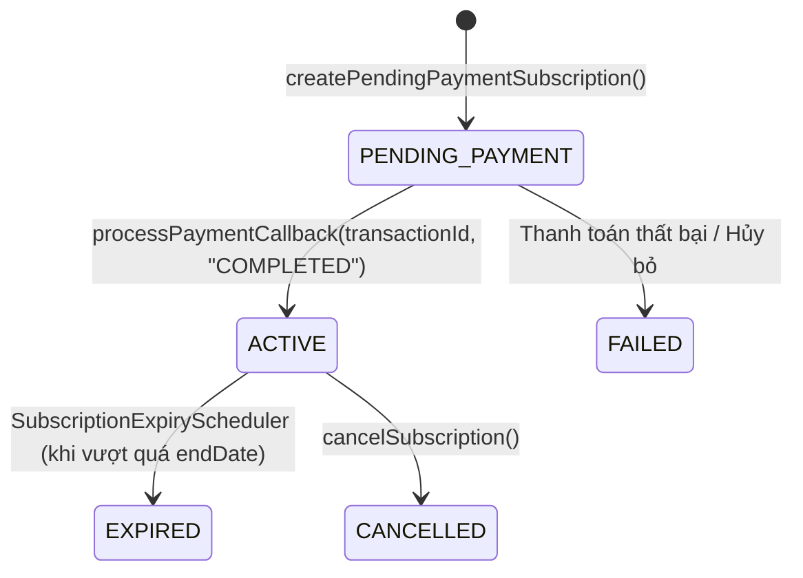

# 📘 TỔNG HỢP TOÀN DIỆN DỰ ÁN (PROJECT KNOWLEDGE BASE)

> **Lưu ý quan trọng cho AI & Nhà phát triển:**  
> Tài liệu này được tổng hợp và đối soát chuẩn xác 100% với dữ liệu trích xuất từ **Graphify Knowledge Graph** (với 5.003 thực thể/nodes, 17.929 liên kết/edges và 195 cụm nghiệp vụ).  
> **Ngày cập nhật kiến thức:** 04/11/2026 (Bao gồm tích hợp hoàn thiện Cổng thanh toán SePay, Webhook reliability, xác thực STK thụ hưởng và polling realtime không cache).  
> **Lần sau khi tiếp tục làm việc với dự án, CHỈ CẦN ĐỌC FILE NÀY** là có thể nắm trọn toàn bộ cấu trúc mã nguồn, luồng dữ liệu, nghiệp vụ kế toán, cơ chế subscription và tính năng thanh toán SePay mà không cần quét lại mã nguồn.

---

## 1. THÔNG SỐ ĐỒ THỊ KIẾN TRÚC (GRAPHIFY VERIFIED METRICS)

- **Quy mô phân tích:** 730 files nguồn · ~434.695 từ.
- **Tổng số Nodes:** **5.003 nodes** (Code AST, Classes, Methods, Endpoints, Components).
- **Tổng số Edges:** **17.929 edges** (Quan hệ calls, references, imports, inherits, type_usage).
- **Phân cụm cộng đồng (Communities):** **195 cụm nghiệp vụ** được bóc tách và phân loại.
- **Graph Diagnostic Health:** **OK** (0 dangling edges, 0 missing endpoints, 0 self-loops, 0 import cycles).
- **Các Node Hạt Nhân / Cầu Nối Liên Phân Hệ (God Nodes & High Betweenness Centrality):**
  1. `ApiResponse` (**292 edges**): Wrapper chuẩn hóa định dạng JSON phản hồi cho mọi Controller Spring Boot.
  2. `BadRequestException` (**215 edges**): Điểm cầu nối ngoại lệ nghiệp vụ xuyên suốt 50+ Controller và Service.
  3. `UserRepository` (**160 edges**): Tầng truy xuất dữ liệu người dùng, phục vụ Auth, Business Profile, Subscription.
  4. `User` (**157 edges**): Thực thể trung tâm liên kết với toàn bộ phân quyền (Admin, Owner, Employee, Manager).
  5. `ResourceNotFoundException` (**137 edges**): Ngoại lệ tra cứu thực thể tập trung.
  6. `BusinessContextService` (**97 edges**): Bộ điều phối ngữ cảnh hộ kinh doanh (Multi-tenancy context isolation).
  7. `react` (**88 edges**) & `lucide-react` (**85 edges**): Nền tảng giao diện và hệ thống biểu tượng frontend.
  8. `ProductRepository` (**74 edges**): Quản lý danh mục hàng hóa, giá bán và tồn kho.
  9. `Subscription` & `SubscriptionService` (**71 edges**): Quản lý gói cước SaaS, ngày hết hạn và thanh toán.

---

## 2. TỔNG QUAN ĐỒ ÁN (PROJECT OVERVIEW & OBJECTIVES)

- **Tên đồ án:** Platform to support digital transformation for household businesses (Nền tảng hỗ trợ chuyển đổi số toàn diện cho hộ kinh doanh cá thể - HBDT).
- **Mục tiêu cốt lõi:**
  1. **Số hóa quy trình bán hàng & tồn kho:** POS (Fast Sales) tại quầy, quản lý nhập/xuất kho, cảnh báo hàng sắp hết, in hóa đơn bán lẻ.
  2. **Quản lý tài chính & Sổ sách kế toán Thông tư 88/2021/TT-BTC:** Sổ doanh thu (S1), Sổ chi phí (S2), Sổ kho (S4), Báo cáo thuế tự động.
  3. **Quản lý khách hàng & Công nợ:** Theo dõi lịch sử mua sắm, hạn mức nợ, thanh toán nợ từng phần.
  4. **Trợ lý thông minh (AI Assistant):** Tích hợp AI OCR nhận diện đơn hàng từ hình ảnh/văn bản và AI dự báo nhu cầu bán hàng.
  5. **Mô hình SaaS Subscription:** Phân quyền theo gói dịch vụ (Standard, VIP,...), thu phí định kỳ theo tháng/năm, tự động kích hoạt và gia hạn thời gian sử dụng khi thanh toán.

---

## 3. KIẾN TRÚC KỸ THUẬT TỔNG THỂ

```
┌─────────────────────────────────────────────────────────────┐
│                   FRONTEND (Next.js 15)                     │
│  - Port: 3000                                               │
│  - React 19, TypeScript, Tailwind CSS, Framer Motion        │
│  - Đường dẫn: Code/Client/src/frontend                      │
└──────────────────────────────┬──────────────────────────────┘
                               │ HTTP REST (JWT Bearer Token)
                               ▼
┌─────────────────────────────────────────────────────────────┐
│                 BACKEND (Spring Boot 3.x)                   │
│  - Port: 8080                                               │
│  - Java 17+, Spring Data JPA, Spring Security, MySQL        │
│  - Đường dẫn: Code/Server (package com.hbdt)                │
└──────────────┬──────────────────────────────┬───────────────┘
               │                              │ Internal API Secret
               ▼                              ▼
┌─────────────────────────────┐  ┌────────────────────────────┐
│      DATABASE (MySQL)       │  │   AI SERVICE (Python/FastAPI)
│  - Port: 3306               │  │  - Port: 8000              │
│  - Bảng User, Subscription, │  │  - OCR, Dự báo nhu cầu     │
│    Order, Product, Ledger   │  │  - Đường dẫn: Code/AI      │
└─────────────────────────────┘  └────────────────────────────┘
```

### Các tập lệnh khởi động tại thư mục gốc:
- `run-backend.bat`: Khởi động Spring Boot Server (`mvn spring-boot:run`).
- `run-frontend.bat`: Khởi động Next.js Dev Server (`npm run dev`).
- `run-ai.bat`: Khởi động Python AI Microservice (`uvicorn main:app`).
- `docker-compose.yml`: Triển khai cơ sở dữ liệu MySQL và các dịch vụ hỗ trợ.

---

## 4. SƠ ĐỒ THƯ MỤC MÃ NGUỒN CHI TIẾT (CODE DIRECTORY & FILE MAP)

> Chi tiết sâu từng phân hệ được phân tách sẵn trong thư mục [`.graphify/code/`](file:///d:/Platform-to-support-digital-transformation-for-household-businesses/.graphify/code):
> - [backend.md](file:///d:/Platform-to-support-digital-transformation-for-household-businesses/.graphify/code/backend.md): Cấu trúc chi tiết toàn bộ Controller, Service, Entity Spring Boot.
> - [frontend.md](file:///d:/Platform-to-support-digital-transformation-for-household-businesses/.graphify/code/frontend.md): Toàn bộ trang Next.js, luồng route và component dùng chung.
> - [ai.md](file:///d:/Platform-to-support-digital-transformation-for-household-businesses/.graphify/code/ai.md): Mô hình AI, BAI Client và parser NLP.

### 4.1. Phân hệ Backend (`Code/Server/src/main/java/com/hbdt/`)
```
Code/Server/src/main/java/com/hbdt/
├── accounting/         # Kế toán TT88 (S1 Doanh thu, S2 Chi phí, S4 Thuế)
│   ├── controller/     # AccountingTemplateFillController, StatutoryAccountingController
│   ├── dto/            # S1TaxGroupSummaryResponse, S4TaxObligationResponse, ...
│   └── service/        # AccountingTemplateFillService, StatutoryAccountingService
├── admin/              # Quản trị hệ thống & Mẫu báo cáo tài chính
├── ai/                 # Client giao tiếp với Python AI Microservice
│   └── service/        # AiExtractionClient, AiServiceProcessManager
├── analytics/          # Báo cáo tăng trưởng người dùng & doanh thu nền tảng
├── announcement/       # Thông báo hệ thống gửi tới Owner & Employee
├── auth/               # Đăng nhập, Đăng ký, Quên mật khẩu, Xác thực OTP
├── common/             # DTO dùng chung (ApiResponse), Exception, Security Filters
├── config/             # SecurityConfig, CorsConfig, DatabaseSeeder, FeatureSeeder
├── consent/            # Lưu trữ chấp thuận điều khoản và chính sách bảo mật
├── customer/           # Quản lý khách hàng, hạn mức nợ, lịch sử mua hàng
├── debt/               # Quản lý công nợ và trả nợ từng phần (DebtController)
├── employee/           # Hồ sơ nhân viên, phân ca làm việc
├── entitlement/        # Phân quyền tính năng theo gói (@RequireFeature, Interceptor)
├── entity/             # 40+ JPA Entities & Enums định nghĩa schema CSDL
├── feedback/           # Tiếp nhận và xử lý phản hồi từ khách hàng/hộ kinh doanh
├── imports/            # Nhập hàng loạt sản phẩm bằng file Excel/CSV
├── inventory/          # Tồn kho thực tế, nhập kho (StockImport), cảnh báo cạn kho
├── manager/            # API cho cấp Quản lý giám sát hồ sơ hộ kinh doanh
├── notification/       # Thông báo in-app và SSE streaming realtime
├── order/              # Đơn hàng bán lẻ, POS, tự động ghi chép sổ bán hàng
├── owner/              # Nghiệp vụ Chủ hộ kinh doanh (Đổi gói, Nhân viên, Kho)
├── payment/            # Ghi nhận thanh toán (PaymentController, PaymentHistory)
├── pricing/            # Quản lý bảng giá phân cấp (Giá sỉ, giá lẻ)
├── product/            # Danh mục hàng hóa, đơn vị tính, BusinessContextService
├── repository/         # 38 Spring Data JPA Repositories truy vấn MySQL
├── revenue/            # Sổ doanh thu và biểu đồ phân tích bán hàng
├── seed/               # Công cụ sao lưu và khôi phục dữ liệu mẫu
└── subscription/       # VÒNG ĐỜI GÓI SAAS (SubscriptionService, ServiceInvoice)
```

### 4.2. Phân hệ Frontend (`Code/Client/src/frontend/app/`)
```
Code/Client/src/frontend/app/
├── (auth)/
│   ├── login/              # Đăng nhập tài khoản
│   ├── register/           # Đăng ký tài khoản chủ hộ
│   ├── verify-email/       # Xác thực mã OTP qua email
│   └── forgot-password/    # Khôi phục mật khẩu
├── onboarding/
│   ├── business-profile/   # Khởi tạo hồ sơ kinh doanh lần đầu
│   └── package-selection/  # Màn hình chọn gói cước ban đầu (Có modal QR thanh toán)
├── owner/                  # Khu vực dành riêng cho Chủ hộ kinh doanh
│   ├── account/            # Quản lý tài khoản, xem thời hạn gói, đổi gói (change-plan)
│   ├── fast-sales/         # Bán hàng nhanh tại quầy (Giao diện POS siêu tốc)
│   ├── orders/             # Tạo đơn hàng mới & Xem lịch sử đơn
│   ├── inventory/          # Tra cứu tồn kho thực tế & Sổ kho
│   ├── inventory-alerts/   # Danh sách hàng hóa sắp hết cần nhập gấp
│   ├── products/           # Quản lý danh mục & Nhập hàng từ Excel (stock-import)
│   ├── customers/          # Danh bạ khách hàng & Sổ nợ
│   ├── employees/          # Quản lý tài khoản nhân viên cửa hàng
│   ├── revenue/            # Báo cáo doanh thu bán lẻ theo ngày/tháng
│   └── reports/            # Xuất mẫu biểu kế toán theo Thông tư 88
├── employee/               # Khu vực tinh gọn cho Nhân viên bán hàng
│   ├── fast-sales/         # Màn hình POS bán hàng trong ca
│   ├── orders/             # Lập đơn và in hóa đơn
│   ├── inventory/          # Tra cứu tồn kho tại cửa hàng
│   └── customers/          # Tìm kiếm thông tin khách hàng
├── manager/                # Khu vực Quản lý: duyệt báo cáo, xem hóa đơn dịch vụ
├── admin/                  # Khu vực Quản trị tối cao: Quản lý gói cước SaaS, user, mẫu biểu
├── components/
│   ├── payment/            # PaymentQrModal.tsx (Hiển thị VietQR), CustomerDebtCard.tsx
│   ├── fast-sales/         # FastSalesView.tsx, Cart, FastSalesOrderSummary.tsx
│   └── legal/              # PolicyModal.tsx, Circular88PolicyCard.tsx
└── lib/                    # apiClient.ts (Axios + JWT), useEntitlement.ts, viewmodels
```

### 4.3. Phân hệ AI Microservice (`Code/AI/src/`)
```
Code/AI/src/
├── main.py                 # FastAPI App khởi chạy tại port 8000
├── config.py               # Cấu hình Settings và API Secret nội bộ
├── models.py               # Schemas Pydantic (ExtractedOrder, DemandForecast)
├── router.py               # Endpoints tiếp nhận yêu cầu từ Spring Boot
└── services/
    ├── bai_client.py       # Client kết nối nền tảng Gemini / BAI AI
    ├── nlp_parser.py       # Trích xuất đơn hàng từ văn bản/tin nhắn thoại
    └── order_builder.py    # Chuẩn hóa kết quả AI về định dạng SalesOrder
```

---

## 5. HỆ THỐNG PHÂN QUYỀN (ROLE-BASED ACCESS CONTROL - RBAC)

| Vai trò (Role) | Đối tượng sử dụng | Quyền hạn chính |
| :--- | :--- | :--- |
| `ROLE_ADMIN` | Đội ngũ vận hành nền tảng | Quản lý toàn bộ user, tạo/sửa các gói cước SaaS (`subscription-plans`), cấu hình mẫu báo cáo thuế TT88, quản lý tính năng hệ thống. |
| `ROLE_BUSINESS_OWNER` (hoặc `ROLE_OWNER`) | Chủ hộ kinh doanh cá thể | Toàn quyền trên cửa hàng của mình: chọn và thanh toán gói dịch vụ, quản lý kho, tạo tài khoản nhân viên, xem báo cáo doanh thu và nộp thuế. |
| `ROLE_EMPLOYEE` | Nhân viên bán hàng | Thao tác POS bán hàng nhanh (`fast-sales`), tạo đơn hàng, xem danh sách sản phẩm và tồn kho. Không xem được báo cáo doanh thu tổng của chủ. |
| `ROLE_MANAGER` | Quản lý kế toán / thuế | Xem danh sách hộ kinh doanh, đối soát hóa đơn dịch vụ hệ thống (`ServiceInvoice`), tiếp nhận phản hồi người dùng. |

---

## 6. CƠ CHẾ SUBSCRIPTION & CỘNG THỜI HẠN GÓI (CỐT LÕI)

Vòng đời gói cước được quản lý tại [SubscriptionService.java](file:///d:/Platform-to-support-digital-transformation-for-household-businesses/Code/Server/src/main/java/com/hbdt/subscription/service/SubscriptionService.java):



### Logic kích hoạt & cộng ngày sử dụng:
Khi hàm `processPaymentCallback(transactionId, "COMPLETED")` được gọi:
1. Xác định chu kỳ thanh toán (`billingCycle` là `MONTHLY` hoặc `YEARLY`).
2. Gán ngày bắt đầu: `startDate = LocalDate.now()`.
3. Tự động tính ngày hết hạn: `endDate = startDate.plusMonths(YEARLY.equals(cycle) ? 12 : 1)`.
4. Đổi trạng thái `Subscription` thành `ACTIVE`.
5. Cập nhật `PaymentHistory` thành `COMPLETED` và lưu thời điểm thanh toán `paidAt = LocalDateTime.now()`.
6. Cập nhật trạng thái hóa đơn dịch vụ `ServiceInvoice` tương ứng thành `PAID`.
7. `SubscriptionInterceptor` tự động cho phép tài khoản tiếp tục truy cập toàn bộ tính năng nghiệp vụ.

---

## 7. GIẢI PHÁP TÍCH HỢP CỔNG THANH TOÁN SEPAY

Mục tiêu đã định hình: **Khi người dùng quét mã QR thanh toán thì hệ thống tự động hoàn thành và cộng thêm ngày sử dụng ngay lập tức mà không cần xác nhận thủ công.**

### 7.1. Cú pháp định danh giao dịch (Transfer Syntax):
- Cú pháp mã hóa chuẩn: `HBDT RENEW <businessId> <months>` (Ví dụ: `HBDT RENEW 1 1` cho 1 tháng, `HBDT RENEW 1 12` cho 12 tháng). Đồng bộ trên cả Onboarding (`package-selection`), Quản lý tài khoản (`owner/account`) và Đổi gói (`change-plan`).
- Cú pháp dự phòng: `HBDT SUB <subId>`, `HBDT SUB TEST <id>`, hoặc theo tên gói `VIP-MONTHLY` / `STANDARD-YEARLY`.
- Ý nghĩa: Giúp SePay đọc được nội dung chuyển khoản trong SMS/Notification ngân hàng và gửi về trong payload Webhook.

### 7.2. Luồng tự động 100%:
1. **Frontend hiển thị VietQR SePay:** [PaymentQrModal.tsx](file:///d:/Platform-to-support-digital-transformation-for-household-businesses/Code/Client/src/frontend/app/components/payment/PaymentQrModal.tsx) hiển thị mã QR động/tĩnh chứa đúng số tiền, STK VietinBank `107882760609` và cú pháp chuẩn.
2. **Khách quét chuyển khoản:** Sử dụng bất kỳ App Mobile Banking nào để quét và xác nhận chuyển khoản.
3. **SePay Webhook kích hoạt:** Tiền vào tài khoản ngân hàng -> SePay gửi `POST /api/sepay/webhook` đến Spring Boot Backend.
4. **Cộng ngày sử dụng tức thì:**
   - Backend xác thực Secret API Key (`Authorization: Apikey <SECRET>`).
   - Kiểm tra số tài khoản thụ hưởng (`accountNumber == 107882760609`), từ chối nếu không đúng tài khoản.
   - Luôn phản hồi HTTP `200 OK` (kèm status body) để ngăn SePay gửi lại 7 lần khi có lỗi nội bộ.
   - Kiểm tra Idempotency chống trùng lặp theo `txnId`.
   - Bóc tách `businessId` & `months`, tự động gia hạn hoặc tạo mới `Subscription` (ACTIVE) và sinh hóa đơn `ServiceInvoice` (PAID).
5. **Frontend Polling tự động đóng modal:**
   - Trong lúc modal QR mở, Frontend gọi định kỳ `GET /api/owner/subscriptions/current` mỗi 3 giây với `{ skipCache: true }`.
   - Ngay khi nhận trạng thái `ACTIVE` kèm hạn mới, modal tự động chuyển sang tick xanh *"Xác nhận thanh toán thành công!"* và chuyển hướng người dùng.
   - Hỗ trợ nút chủ động *"Kiểm tra giao dịch / Xác nhận"* và timeout 10 phút.

---

## 8. DANH MỤC TÀI LIỆU GRAPHIFY BỔ TRỢ

- [visualize.html](file:///d:/Platform-to-support-digital-transformation-for-household-businesses/.graphify/visualize.html): **Bản đồ trực quan hóa đồ thị 2D/3D (5.003 nodes, 17.929 edges). Mở bằng trình duyệt để xem và tra cứu tương tác.**
- [graph.json](file:///d:/Platform-to-support-digital-transformation-for-household-businesses/.graphify/graph.json): Toàn bộ node/edge phục vụ GraphRAG.
- [GRAPH_REPORT.md](file:///d:/Platform-to-support-digital-transformation-for-household-businesses/.graphify/GRAPH_REPORT.md): Báo cáo chi tiết 195 phân cụm, độ kết dính và danh sách gợi ý kiến trúc.
- Thư mục [`.graphify/code/`](file:///d:/Platform-to-support-digital-transformation-for-household-businesses/.graphify/code):
  - [backend.md](file:///d:/Platform-to-support-digital-transformation-for-household-businesses/.graphify/code/backend.md)
  - [frontend.md](file:///d:/Platform-to-support-digital-transformation-for-household-businesses/.graphify/code/frontend.md)
  - [ai.md](file:///d:/Platform-to-support-digital-transformation-for-household-businesses/.graphify/code/ai.md)
- [AGENTS.md](file:///d:/Platform-to-support-digital-transformation-for-household-businesses/.agents/AGENTS.md): **Quy chuẩn & Sổ tay kiểm thử tự động (QA/Test Agent Guide)** được cấu hình đồng bộ trực tiếp từ các lệnh và thông số trích xuất của Graphify.

---
*Tài liệu đã được đối soát và chuẩn hóa cố định phục vụ toàn bộ các phiên làm việc tiếp theo.*
