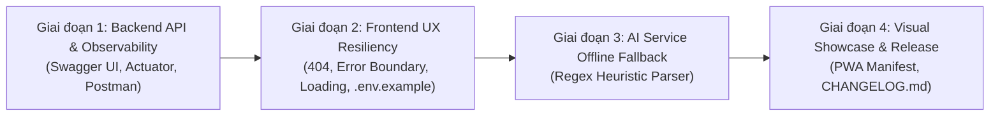

# 📋 KẾ HOẠCH NÂNG CẤP DỰ ÁN ĐẠT CHUẨN PRODUCTION & TỐI ƯU HỒ SƠ TUYỂN DỤNG (CV)

> **Dự án:** Nền tảng Hỗ trợ Chuyển đổi Số cho Hộ Kinh doanh (Platform to Support Digital Transformation for Household Businesses - HBDT)  
> **Mã kế hoạch:** `PLAN-CV-PRODUCTION-READINESS-2026`  
> **Ngày lập kế hoạch:** 21/11/2026  
> **Định hướng mục tiêu:** Tối ưu hóa dự án đạt chuẩn **Production-Grade (Sản phẩm thực tế doanh nghiệp)**, nâng cao tối đa điểm số kỹ thuật khi nhà tuyển dụng (Tech Lead / Hiring Manager) duyệt GitHub repository từ CV của ứng viên.

---

## 1. BẢNG PHÂN TÍCH HIỆN TRẠNG & KHOẢNG TRỐNG (GAP ANALYSIS)

| Phân hệ / Hạng mục | Hiện trạng | Khoảng trống cần hoàn thiện | Mức độ ưu tiên cho CV |
| :--- | :--- | :--- | :---: |
| **Backend API Docs** | 50+ Controllers, 100+ Endpoints | ✅ **Đã hoàn thành:** Tích hợp `springdoc-openapi` Swagger UI (`/swagger-ui.html`, `/v3/api-docs`) phân nhóm 6 cụm API. | 🟢 **Hoàn thành (Done)** |
| **Backend Observability** | Log file thông thường | ✅ **Đã hoàn thành:** Tích hợp Spring Boot Actuator (`/actuator/health`, `/actuator/info`). | 🟢 **Hoàn thành (Done)** |
| **Tài liệu Postman** | Đã xuất bộ sưu tập v2.1 | ✅ **Đã hoàn thành:** `docs/api/hbdt-api.postman_collection.json` & Environment `docs/api/hbdt-local.postman_environment.json`. | 🟢 **Hoàn thành (Done)** |
| **Frontend Error Boundary** | Đã có Not-Found, Error & Loading | ✅ **Đã hoàn thành:** Bổ sung `app/not-found.tsx`, `app/error.tsx`, `app/loading.tsx` chuẩn Dark-Tech & App Router Suspense. | 🟢 **Hoàn thành (Done)** |
| **Frontend Environment** | Có file mẫu cho Developer | ✅ **Đã hoàn thành:** Tạo `Code/Client/src/frontend/.env.example` với đầy đủ mô tả biến môi trường. | 🟢 **Hoàn thành (Done)** |
| **PWA & Mobile POS** | Web chạy trên trình duyệt | Chưa có Web App Manifest (`manifest.ts`) để cài đặt như ứng dụng POS quầy. | 🟢 **Trung bình (Điểm cộng)** |
| **AI Service Resilience** | Yêu cầu API Key live | Báo lỗi 503 khi thiếu key; thiếu fallback parser regex offline để demo. | 🟡 **Cao (Demo friendly)** |
| **Changelog & Release** | Có GitHub Release tag | Chưa có `CHANGELOG.md` chuẩn Keep a Changelog v1.1.0. | 🟢 **Trung bình (Chuyên nghiệp)** |

---

## 2. LỘ TRÌNH 4 GIAI ĐOẠN THỰC THI (PHASED ROADMAP)



---

## 3. CHI TIẾT CÁC HẠNG MỤC KỸ THUẬT

### GIAI ĐOẠN 1: BACKEND OBSERVABILITY & TÀI LIỆU HÓA API (ƯU TIÊN CAO NHẤT)

#### 1.1. Tích hợp Swagger / OpenAPI 3.0 Interactive UI
- **Tệp chỉnh sửa:** `Code/Server/pom.xml`, `Code/Server/src/main/java/com/hbdt/config/OpenApiConfig.java`.
- **Thư viện:** `org.springdoc:springdoc-openapi-starter-webmvc-ui:2.5.0`.
- **Mục tiêu kỹ thuật:**
  * Endpoint truy cập: `http://localhost:8080/swagger-ui.html` và `http://localhost:8080/v3/api-docs`.
  * Cấu hình **JWT Bearer Security Scheme**: Cho phép click nút "Authorize" và dán access token để gọi trực tiếp các API bảo mật (`/api/owner/*`, `/api/admin/*`, `/api/employee/*`).
  * Phân nhóm API (GroupedOpenApi):
    1. `public-apis`: Xác thực, đăng ký, landing page.
    2. `owner-apis`: Nghiệp vụ chủ hộ kinh doanh (POS, kho, đổi gói, nhân viên).
    3. `employee-apis`: POS bán hàng và tra cứu tồn kho ca làm việc.
    4. `manager-apis`: Kiểm duyệt hóa đơn và đối soát số liệu hộ kinh doanh.
    5. `admin-apis`: Quản trị hệ thống, gói cước, mã coupon, mẫu báo cáo thuế.

#### 1.2. Tích hợp Spring Boot Actuator (Cloud-Native Health & Metrics)
- **Tệp chỉnh sửa:** `Code/Server/pom.xml`, `application.properties`, `application-dev.properties`.
- **Thư viện:** `org.springframework.boot:spring-boot-starter-actuator`.
- **Mục tiêu kỹ thuật:**
  * Endpoint sức khỏe: `GET /actuator/health` (trả về trạng thái UP của MySQL và Disk Space).
  * Endpoint thông tin: `GET /actuator/info` (phiên bản phần mềm, Java runtime).
  * Đồng bộ vào `docker-compose.yml` để làm healthcheck chính thống cho container `hbdt-backend`.

#### 1.3. Bộ sưu tập Postman Collection chuẩn (`docs/api/hbdt-api.postman_collection.json`)
- **Tệp tạo mới:** `docs/api/hbdt-api.postman_collection.json` và `docs/api/hbdt-local.postman_environment.json`.
- **Nội dung:**
  * Chứa sẵn các thư mục request: `Auth (Login/Register/OTP)`, `Fast Sales (POS)`, `Inventory & Stock Import`, `Statutory Ledgers TT88 (S1, S2, S4)`, `SePay Webhook Simulation`, `Coupons`.
  * Tự động trích xuất `accessToken` sau khi Login và lưu vào biến môi trường `{{token}}`.

---

### GIAI ĐOẠN 2: FRONTEND UX RESILIENCY & APP ROUTER POLISH

#### 2.1. Trang 404 Không Tìm Thấy Trang (`app/not-found.tsx`)
- **Vị trí:** `Code/Client/src/frontend/app/not-found.tsx`.
- **Thiết kế:**
  * Phong cách Dark-Tech hiện đại đồng bộ với Header & Brand Footer.
  * Hiệu ứng neon ánh xanh/tím, icon `FileQuestion` hoặc `Compass`.
  * Thông báo song ngữ thân thiện: *"404 - Trang không tồn tại hoặc đã được di chuyển"*.
  * Các nút điều hướng nhanh: *"Về Trang Chủ"*, *"Đến Bảng Điều Khiển"*, *"Liên hệ Hỗ trợ"*.

#### 2.2. Global Error Boundary (`app/error.tsx`)
- **Vị trí:** `Code/Client/src/frontend/app/error.tsx` (Client Component `'use client'`).
- **Thiết kế:**
  * Bắt toàn bộ lỗi runtime trong cây component React mà không làm trắng màn hình.
  * Hiển thị mã lỗi, digest, nút *"Thử lại (Reset)"* để gọi hàm `reset()`.

#### 2.3. Suspense Skeleton Loader (`app/loading.tsx`)
- **Vị trí:** `Code/Client/src/frontend/app/loading.tsx`.
- **Thiết kế:**
  * Hiển thị animation Pulse nhẹ nhàng khi Next.js chuyển trang giữa các route nặng (Dashboard, Fast Sales POS, Sổ doanh thu).

#### 2.4. Tệp Môi trường Mẫu (`Code/Client/src/frontend/.env.example`)
- **Nội dung:**
  ```properties
  # HBDT Platform — Frontend Environment Configuration
  NEXT_PUBLIC_API_URL=http://localhost:8080
  NEXT_PUBLIC_AI_URL=http://localhost:8000
  ```

---

### GIAI ĐOẠN 3: AI SERVICE RESILIENCE & OFFLINE DEMO PARSER

#### 3.1. Heuristic Regex Fallback Parser
- **Vị trí:** `Code/AI/src/services/heuristic_parser.py`.
- **Mục tiêu kỹ thuật:**
  * Khi `BAI_API_KEY` bị thiếu, hết hạn credit, hoặc môi trường phỏng vấn không có mạng, hệ thống không báo lỗi 503 mà kích hoạt bộ phân tích Heuristic dựa trên pattern tiếng Việt:
    * Mẫu số lượng: `(\d+)\s*(thùng|chai|lon|cây|gói|hộp|bao|kg|lạng)?\s*([a-zA-ZÀ-ỹ0-9\s]+)`
    * Bóc tách các mặt hàng thông dụng: bia tiger, nước ngọt pepsi, mì hảo hảo, gạo st25, thuốc lá 555.
  * Trả về kết quả `ExtractedOrder` chuẩn schema Pydantic, giúp tính năng AI POS vẫn demo được 100% trơn tru.

---

### GIAI ĐOẠN 4: VISUAL SHOWCASE, PWA & GOVERNANCE

#### 4.1. Web App Manifest cho POS (`app/manifest.ts`)
- **Vị trí:** `Code/Client/src/frontend/app/manifest.ts`.
- **Mục tiêu kỹ thuật:**
  * Định nghĩa tên `HBDT POS - Bán Hàng Nhanh`, theme color `#09090b` (zinc-950), display `standalone`.
  * Cho phép người dùng hoặc nhà tuyển dụng "Install app" trực tiếp từ trình duyệt Edge/Chrome để trải nghiệm như một ứng dụng Native trên Desktop/Tablet.

#### 4.2. Nhật Ký Phiên Bản Quốc Tế (`CHANGELOG.md`)
- **Vị trí:** Thư mục gốc `CHANGELOG.md`.
- **Tiêu chuẩn:** Tuân thủ 100% [Keep a Changelog v1.1.0](https://keepachangelog.com/) và Semantic Versioning (`v1.0.0-RELEASE`).
- **Nội dung:** Ghi nhận toàn bộ tính năng theo các mục `Added`, `Changed`, `Fixed`, `Security`.

---

## 4. TIÊU CHÍ ĐÁNH GIÁ THÀNH CÔNG (SUCCESS CRITERIA)

1. ✅ **Swagger UI:** Mở được `http://localhost:8080/swagger-ui.html`, hiển thị đầy đủ danh mục API và cho phép Authorize JWT test trực tiếp.
2. ✅ **Actuator:** `GET /actuator/health` phản hồi `{"status":"UP"}` với thông tin DB connection.
3. ✅ **Next.js Error Pages:** Truy cập `/invalid-url-test` hiển thị trang 404 Dark-Tech chuẩn HBDT.
4. ✅ **Client Environment:** Thư mục `Code/Client/src/frontend` có `.env.example` chuẩn mực.
5. ✅ **AI Demo:** Gọi thử API parse order khi không có API key vẫn trích xuất được đơn hàng mẫu qua heuristic fallback.
6. ✅ **Build & Test CI:** Cả 3 job GitHub Actions CI pipeline tiếp tục pass 100% Xanh sau khi bổ sung các thư viện mới.

---

## 5. ĐỀ XUẤT NHÁNH GIT & QUY TRÌNH COMMIT

* **Nhánh thực hiện:** `feat/cv-production-readiness` (tách từ `main`).
* **Các commit dự kiến:**
  1. `[FEAT] backend: integrate Springdoc OpenAPI Swagger UI and Actuator health endpoints`
  2. `[FEAT] frontend: add custom 404 not-found, error boundary, loading skeleton, and .env.example`
  3. `[FEAT] ai: add heuristic fallback parser for offline order extraction demo`
  4. `[DOCS] api: export Postman collection and generate CHANGELOG.md v1.0.0`
