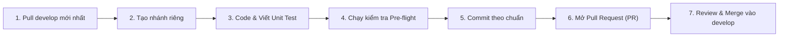

# 🤝 HƯỚNG DẪN ĐÓNG GÓP MÃ NGUỒN (CONTRIBUTING GUIDELINES)

> **Dự án:** Nền tảng Hỗ trợ Chuyển đổi Số cho Hộ Kinh doanh (Platform to Support Digital Transformation for Household Businesses - HBDT)  
> **Áp dụng cho:** Tất cả các thành viên trong nhóm phát triển và các cộng tác viên đóng góp mã nguồn.  
> **Ngôn ngữ cam kết:** Java 21 (Spring Boot 3.3), TypeScript / React 19 (Next.js 16), Python 3.12 (FastAPI).

Cảm ơn bạn đã tham gia phát triển dự án **HBDT Platform**! Tài liệu này quy định toàn bộ tiêu chuẩn về quy trình làm việc nhóm trên Git, quy ước đặt tên commit, chiến lược phân nhánh và tiêu chí kiểm thử nhằm đảm bảo mã nguồn luôn ổn định, chất lượng và dễ bảo trì.

---

## 1. Chiến Lược Phân Nhánh (Branching Strategy)

Dự án áp dụng mô hình **Git Feature Branch Workflow** xoay quanh nhánh tích hợp trung tâm `develop`:

```
main        ─────────────────────────────────────────────● (v1.0 Release)
                                                         ▲
                                                         │ (Merge PR)
develop     ──────●───────────────●──────────────────────●────── (Active Dev)
                  │               ▲                      ▲
                  │ (Checkout)    │ (PR)                 │ (PR)
feature/...       └───────────────┘                      │
fix/...           └──────────────────────────────────────┘
```

### 1.1. Các nhánh chính (Long-lived Branches)
* **`main`**: Nhánh lưu trữ phiên bản sản phẩm hoàn thiện, ổn định nhất (Production-ready). Chỉ nhận code thông qua Pull Request từ `develop` sau khi đã kiểm thử toàn diện.
* **`develop`**: Nhánh phát triển chính (Default branch). Toàn bộ tính năng mới, sửa lỗi và cập nhật tài liệu đều được tích hợp vào nhánh này.

### 1.2. Quy ước đặt tên nhánh công việc (Feature/Task Branches)
Mỗi khi bắt đầu làm một nhiệm vụ (Task / Issue / Ticket Jira), hãy tạo một nhánh mới từ `develop` theo tiền tố quy định:

| Tiền tố nhánh | Mục đích sử dụng | Ví dụ thực tế trong dự án |
| :--- | :--- | :--- |
| `feature/` hoặc `feat/` | Phát triển tính năng mới | `feat/sepay`, `feature/AI_Service`, `feature/HBDT-113-RBAC` |
| `fix/` | Sửa lỗi (bug fixes) | `fix/refresh-jwt-token`, `fix/backend-database-integration` |
| `ui/` hoặc `UI/` | Tinh chỉnh giao diện người dùng | `ui/payment`, `UI/adjust-manager-ui` |
| `docs/` | Bổ sung, cập nhật tài liệu | `docs/add-compliance`, `docs/add-installation-and-user-guide` |
| `refactor/` | Tái cấu trúc mã nguồn (không đổi tính năng) | `Refactor/edit-project-info` |

*Lệnh tạo nhánh:*
```bash
git checkout develop
git pull origin develop
git checkout -b feature/ten-tinh-nang
```

---

## 2. Quy Ước Đặt Tên Commit (Commit Message Conventions)

Lịch sử commit của HBDT được chuẩn hóa chặt chẽ để phục vụ tra cứu, sinh Changelog và theo dõi tiến độ. Mỗi commit message cần tuân theo định dạng chuẩn:

```
[TYPE] <mô tả ngắn gọn về thay đổi>
hoặc
type(scope): <mô tả ngắn gọn về thay đổi>
```

### 2.1. Bảng phân loại Commit Type được sử dụng trong dự án

| Commit Type | Ý nghĩa & Khi nào sử dụng | Ví dụ thực tế từ lịch sử Git của dự án |
| :--- | :--- | :--- |
| **`[FEAT]`** hoặc `feat:` | Thêm mới tính năng hoặc mở rộng chức năng nghiệp vụ | `[FEAT] default to official qr-code.jpg and add toggle between official QR and dynamic VietQR`<br>`[FEAT] implement automated bank transfer webhook listener and subscription activation for sepay`<br>`[FEAT] support 20-character alphanumeric bypass key` |
| **`[FIX]`** hoặc `fix:` | Sửa lỗi nghiệp vụ, logic tính toán hoặc lỗi giao diện | `[FIX] full SePay integration fixes for transfer syntax, webhook reliability and polling`<br>`[FIX] correct recipient bank account number to 107882760609 from qr-code.jpg`<br>`[FIX] allow deleting leading zero on maxUses input` |
| **`[UI]`** | Chỉnh sửa kiểu dáng (CSS/Tailwind), bố cục, animation hoặc component giao diện | `[UI] Minor adjustment on qr options`<br>`[UI] Adjust minor issues of UI`<br>`[UI] Seperate UI of changing plan and subcription register plan` |
| **`[DOCS]`** hoặc `docs:` | Cập nhật tài liệu kỹ thuật, hướng dẫn sử dụng, test cases | `docs: synchronize all project documentation, test cases and update revision dates to 04/11/2026 for SePay integration`<br>`[DOCS] Update streamline for team members in docs/final-report/phan-cong-nhiem-vu-nhom.md`<br>`[DOCS] summary docs/* folder` |
| **`[TEST]`** hoặc `test:` | Thêm mới hoặc sửa đổi bộ kiểm thử Unit Test / Integration Test | `[TEST] add unit tests for bypass key services and fix AiServiceTest constructor` |
| **`[CHORE]`** hoặc `chore:` | Cấu hình dự án, seed database, cập nhật `.gitignore`, dependencies | `chore: seed data`<br>`[CHORE] update gitignore`<br>`chore(seed): update database seed data and bypass keys` |
| **`[GRAPHIFY]`** | Cập nhật đồ thị tri thức kiến trúc mã nguồn (GraphRAG) | `[GRAPHIFY] add graphify (code and project architecture in graph)` |
| **`[REFACTOR]`** | Tái cấu trúc mã nguồn, dọn dẹp code thừa mà không thay đổi hành vi | `[REFACTOR] simplify transaction query logic in SepayWebhookService` |

### 2.2. Những điểm cần lưu ý khi viết Commit:
* Dùng thì hiện tại, thể mệnh lệnh (vd: `add bypass key...`, `fix webhook...`, không dùng `added...` hay `fixed...`).
* Viết súc tích nhưng nêu rõ bản chất vấn đề được giải quyết.
* Không commit chung nhiều thay đổi không liên quan vào cùng một commit (hãy tách nhỏ các commit có ý nghĩa độc lập).

---

## 3. Quy Trình Đóng Góp Từng Bước (Contribution Step-by-Step)



### Bước 1: Đồng bộ mã nguồn
Luôn đảm bảo nhánh `develop` trên máy local trùng khớp với remote trước khi làm việc:
```bash
git checkout develop
git pull origin develop
```

### Bước 2: Tạo nhánh công việc
```bash
git checkout -b feature/ten-tinh-nang
```

### Bước 3: Phát triển mã nguồn & kiểm thử cục bộ
* **Đường dẫn thư mục dự án:** Tuyệt đối không đặt trong thư mục có dấu tiếng Việt hoặc khoảng trắng (vd: tránh `D:\Đồ Án\...`, dùng `D:\Projects\...`).
* **Biến môi trường:** Không thay đổi các giá trị mặc định của hệ thống trong file `.env.example`. File `.env` thật phải nằm trong `.gitignore`.

### Bước 4: Kiểm tra chất lượng trước khi commit (Pre-flight Checklist)
Trước khi tạo commit và đẩy code lên, bạn **bắt buộc** phải kiểm tra thành công các tiêu chí sau:

1. **Backend Java Spring Boot:**
   ```powershell
   cd Code/Server
   # Đảm bảo JAVA_HOME trỏ đến JDK 21
   .\mvnw clean compile
   .\mvnw test -Dtest="!AiServiceTest"
   ```
   *(Toàn bộ Unit Tests phải pass 100%, không phát sinh lỗi biên dịch).*

2. **Frontend Next.js:**
   ```powershell
   cd Code/Client/src/frontend
   # Kiểm tra lỗi cú pháp TypeScript
   npx tsc --noEmit
   # Chạy bộ test nghiệp vụ kho & công nợ
   npm run test:inventory
   npm run test:debt
   ```
   *(0 lỗi Type check, toàn bộ test cases pass).*

### Bước 5: Tạo Commit và Push nhánh
```bash
git add <cac-file-thay-doi>
git commit -m "[FEAT] mo ta tinh nang vua lam"
git push -u origin feature/ten-tinh-nang
```

### Bước 6: Mở Pull Request (PR)
* Truy cập repository trên GitHub: `https://github.com/Sleepy2608/Platform-to-support-digital-transformation-for-household-businesses`
* Chọn **Compare & pull request**.
* **Base branch:** Chọn `develop` (không chọn `main`).
* **Title:** Điền theo đúng định dạng commit (vd: `[FEAT] Tích hợp cổng thanh toán SePay`).
* **Nội dung PR:** Mô tả tóm tắt tính năng, danh sách test case đã chạy, đính kèm ảnh chụp màn hình kiểm thử nếu có.
* Gán **Reviewer** (Team Leader hoặc thành viên phụ trách mảng liên quan).

### Bước 7: Phê duyệt và Merge
* Ít nhất 1 reviewer xem xét và chấp thuận (Approved).
* Xử lý hết các xung đột (nếu có) bằng cách merge `develop` vào nhánh cá nhân trước khi merge ngược lại.

---

## 4. Các Quy Tắc An Toàn Git Bắt Buộc (Strict Safety Rules)

> [!CAUTION]
> **NHỮNG HÀNH ĐỘNG TUYỆT ĐỐI BỊ NGHIÊM CẤM:**
> 1. **TUYỆT ĐỐI KHÔNG `git push --force`** lên các nhánh dùng chung (`main`, `develop`).
> 2. **KHÔNG COMMIT TRỰC TIẾP** vào `main` hoặc `develop` khi chưa thông qua Pull Request.
> 3. **KHÔNG COMMIT CÁC TÀI LIỆU NHẠY CẢM:** Mật khẩu MySQL thật, API Key riêng tư (`BAI_API_KEY`, `SEPAY_SECRET_KEY`), file `.env`.
> 4. **KHÔNG COMMIT FILE RÁC & BUILD ARTIFACTS:**
>    - Thư mục build: `target/`, `.next/`, `node_modules/`, `build/`
>    - Thư mục môi trường ảo Python: `.venv/`, `__pycache__/`
>    - File cache tạm của Graphify: `.graphify/cache/`, `.graphify_ast.json`, `.graphify_extract.json` (chỉ dùng `git add -f` cho các file tài liệu tổng hợp của Graphify).

---

## 5. Danh Sách Phân Công Phụ Trách & Hỗ Trợ Kỹ Thuật

Mọi thắc mắc về kiến trúc, database, nghiệp vụ kế toán hoặc review code, vui lòng liên hệ thành viên phụ trách chuyên trách:

| Chuyên trách | Thành viên phụ trách | GitHub |
| :--- | :--- | :--- |
| **Quản trị chung & Lead Architect** | **Nguyễn Lê Huy Tâm** (Leader) | [@Sleepy2608](https://github.com/Sleepy2608) |
| **UI/UX & Giao diện Next.js** | **Trần Duy Tân** | [@dzytan](https://github.com/dzytan) |
| **Kiểm thử hệ thống & Backend QA** | **Trần Văn Ngọc Thắng** | [@Thang414](https://github.com/Thang414) |
| **Cơ sở dữ liệu MySQL & Schema** | **Nguyễn Ngọc Gia Bảo** | [@Baon5824](https://github.com/Baon5824) |
| **Nghiệp vụ Bán hàng & Backend** | **Trần Hồng Sơn** | [@sontran310306](https://github.com/sontran310306) |
| **Kế toán TT88 & Báo cáo tài chính** | **Huỳnh Đình Chấn** | [@Chan-2006](https://github.com/Chan-2006) |

---
*Chúc nhóm phát triển làm việc hiệu quả và cùng đưa đồ án HBDT Platform về đích xuất sắc!*

