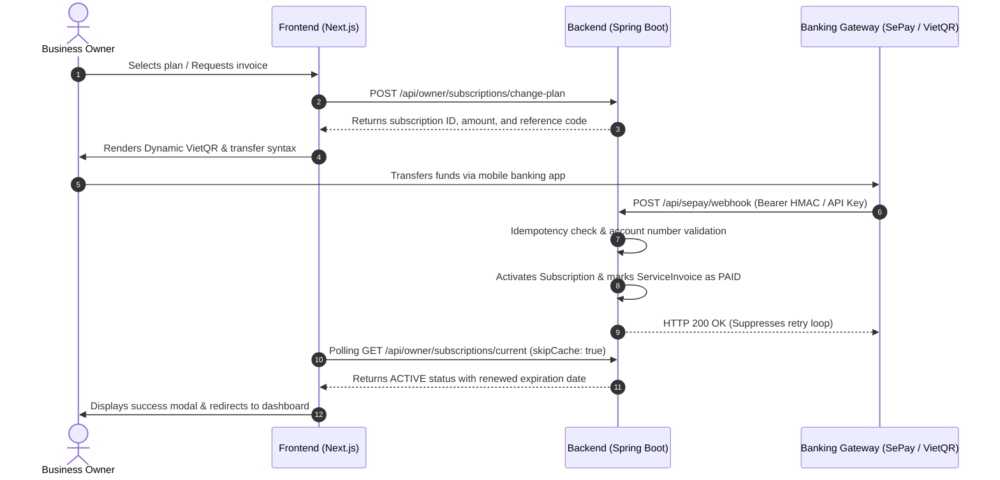

<div align="center">
  <h1>Platform to Support Digital Transformation for Household Businesses (HBDT)</h1>
  
  <br><br>
  <p><em>
    <b>Topic:</b> Digital Transformation Platform for Individual Household Businesses & Micro-Merchants <br>
    <b>Course:</b> Java Programming & Full-Stack Software Engineering
  </em></p>
  <p>
    <a href="https://github.com/Sleepy2608/Platform-to-support-digital-transformation-for-household-businesses/actions/workflows/ci.yml">
      
    </a>
    <a href="https://github.com/Sleepy2608/Platform-to-support-digital-transformation-for-household-businesses/releases">
      
    </a>
    <a href="LICENSE">
      
    </a>
  </p>
  <p>
    
    
    
    
    
    
  </p>
  <p>
    <a href="README.md">🇻🇳 Tiếng Việt</a> &nbsp;|&nbsp; <b>🇬🇧 English</b>
  </p>
</div>

---

## Table of Contents

1. [Overview & Core Value](#overview--core-value)
2. [High-Level Technical Architecture](#high-level-technical-architecture)
3. [Key Modules & Capabilities](#key-modules--capabilities)
4. [Pluggable Payment & Webhook Architecture](#pluggable-payment--webhook-architecture)
5. [Configurable Compliance & Statutory Ledger Engine](#configurable-compliance--statutory-ledger-engine)
6. [SaaS Subscription Plans](#saas-subscription-plans)
7. [Development Team & Contributions](#development-team--contributions)
8. [Project Deployment Status](#project-deployment-status)
9. [Getting Started & Local Setup](#getting-started--local-setup)
10. [Automated Testing & CI/CD Pipeline](#automated-testing--cicd-pipeline)
11. [Community Standards & License](#community-standards--license)

---

## Overview & Core Value

**HBDT Platform** is an enterprise-grade, cloud-ready software-as-a-service (SaaS) platform built to address the unique operational challenges of **individual household businesses, micro-merchants, and boutique retailers**. 

### The Core Challenges It Solves:
1. **Inefficient Manual Checkout:** Traditional physical store checkouts are slowed down by manual calculation and paper notebooks.
2. **Disconnected Inventory & Supply:** Retailers struggle with stockout surprises and lack visibility over reorder thresholds.
3. **Statutory Tax & Regulatory Burden:** Changing accounting decrees and complex bookkeeping obligations impose heavy compliance costs on micro-businesses.
4. **Complex Debt Tracking:** Fragmented customer store credit (buy-now-pay-later) leads to uncollected balances and bookkeeping errors.

### The Solution:
HBDT integrates an ultra-fast **Point-of-Sale (POS)** interface, **real-time stock balance tracking**, **AI-assisted conversational order parsing**, an **automated statutory bookkeeping engine**, and an **event-driven banking webhook integration** into a unified modern web system.

---

## High-Level Technical Architecture

The platform adopts a decoupled multi-tier architecture containerized with Docker:

```
┌─────────────────────────────────────────────────────────────┐
│                   FRONTEND (Next.js 16)                     │
│  - Port: 3000                                               │
│  - React 19, TypeScript, Tailwind CSS v4, Framer Motion     │
│  - Path: Code/Client/src/frontend                           │
└──────────────────────────────┬──────────────────────────────┘
                               │ HTTP REST + JWT Bearer Token
                               ▼
┌─────────────────────────────────────────────────────────────┐
│                 BACKEND (Spring Boot 3.3)                   │
│  - Port: 8080                                               │
│  - Java 21 (Eclipse Temurin), Maven, Spring Data JPA,       │
│    Spring Security (RBAC), Multi-tenant context isolation   │
│  - Path: Code/Server (package com.hbdt)                     │
└──────────────┬──────────────────────────────┬───────────────┘
               │                              │ Internal HMAC Secret
               ▼                              ▼
┌─────────────────────────────┐  ┌────────────────────────────┐
│      DATABASE (MySQL 8)     │  │   AI SERVICE (FastAPI)     │
│  - Port: 3306               │  │  - Port: 8000              │
│  - Database:                │  │  - Python 3.12, Gemini/BAI │
│    household_business_plat  │  │  - NLP & Demand Forecast   │
│    form                     │  │  - Path: Code/AI           │
└─────────────────────────────┘  └────────────────────────────┘
```

### Infrastructure & Containerization:
* `docker-compose.yml`: Coordinates 4 microservices with standardized hostnames (`hbdt-frontend`, `hbdt-backend`, `hbdt-ai-service`, `hbdt-mysql`).
* Healthchecks, automated database initialization (`init.sql`), and persistent volumes ensure predictable single-command deployments.

---

## Key Modules & Capabilities

### 1. Ultra-Fast POS (Point of Sale)
- Single-screen keyboard-first sales interface (`/owner/fast-sales`, `/employee/fast-sales`).
- Barcode and diacritic-insensitive fuzzy search.
- Multi-unit price conversion (e.g., retail can vs. wholesale carton).
- Thermal receipt preview and vector PDF printing (`jspdf`).

### 2. Real-Time Stock Balance & Supply Alerts
- Live stock balance calculations with multi-warehouse context support.
- Low-stock threshold alert system with configurable replenishment triggers.
- Batch Excel/CSV bulk import with automated schema validation and error reporting.

### 3. Smart AI Assistant (Vision OCR & NLP)
- Conversational Vietnamese order parsing (voice memos or text chats) translated into structured `SalesOrder` entities.
- Algorithmic demand forecasting for inventory replenishment planning.

### 4. Role-Based Access Control (RBAC) & Multi-Tenancy
Four discrete roles with strict database-level and token-level context segregation:
* `ROLE_ADMIN`: Global platform oversight, SaaS tier configuration, compliance template design, and user audits.
* `ROLE_BUSINESS_OWNER`: Store configuration, staff quota management, financial reports, and plan upgrades.
* `ROLE_EMPLOYEE`: Shift POS operations, order creation, customer lookup, and stock balance queries.
* `ROLE_MANAGER`: Administrative oversight, service invoice audits, and merchant ticket resolution.

### 5. SaaS Subscription Lifecycle & Promotions
- Dynamic feature gating with `@RequireFeature` annotations and frontend `FeatureGate` components.
- Automated daily expiry scheduler (`SubscriptionExpiryScheduler`).
- Promotional coupon management (`CouponManagementService`) allowing percentage discounts, usage quotas, and expiry enforcement.

---

## Pluggable Payment & Webhook Architecture

The platform implements an **event-driven, zero-fee payment processing pipeline** built on the **Strategy & Adapter Pattern**.



### Defensive Reliability Engineering:
* **Idempotency Guarantee:** Validates incoming transaction IDs against recorded history to eliminate double-crediting.
* **Beneficiary Account Locking:** Verifies recipient bank account numbers against system configuration (`107882760609`).
* **Resilience Retry Defense:** Always returns `200 OK` (with operational status in the JSON response body) to prevent webhook providers from launching retry storms during internal faults.
* **Auto-Provisioning Fallback:** Automatically generates active subscription records if a merchant transfers without a pre-existing invoice.

> [!TIP]
> ### 🌐 International Extensibility Note (Adapting for Global Use)
> * **Domestic Reference:** The included reference implementation uses **VietQR** and **SePay Webhooks** to leverage Vietnam's instant zero-fee interbank transfer network.
> * **Global Payment Providers:** Because the payment handler is abstracted behind clear service interfaces (`PaymentService`, `ServiceInvoiceService`), developers can replace or augment it with global providers such as **Stripe, PayPal, Adyen, or Razorpay** by implementing an adapter class.
> * **Offline Development Mode:** A built-in Mock Payment mode allows local testing without external bank accounts.

---

## Configurable Compliance & Statutory Ledger Engine

HBDT features a **dynamic, data-driven statutory accounting and compliance engine** designed to reduce regulatory overhead.

### Domestic Reference Implementation: Circular 88/2021/TT-BTC
Out of the box, the system comes pre-configured with statutory accounting ledgers mandated by the Vietnamese Ministry of Finance:
1. **S1-HKD (General Revenue & Sales Ledger):** Gathers taxable and non-taxable retail revenue, categorized by VAT and personal income tax rate groups.
2. **S2-HKD (Materials, Tools & Goods Inventory Ledger):** Tracks opening inventory balances, inward stock receipts, outward sales distributions, and period-end balances.
3. **S4-HKD (Tax Obligations & Budget Contribution Ledger):** Calculates statutory tax liabilities and records remittance receipts.

All ledgers support live on-screen review, export to Excel/CSV with **UTF-8 BOM encoding** for compatibility with spreadsheet software, and official PDF generation.

> [!NOTE]
> ### 🌍 Customization Note (Adapting for Regional Regulations)
> * **Data-Driven Architecture:** The compliance module is not hardcoded. It utilizes a configurable template subsystem (`TemplateAdminController`, `ReportTemplateAdminService`, `AccountingTemplateFillService`).
> * **Regional Customization:** Developers can adapt formulas, column headers, tax rates, and export layouts to match local statutory requirements outside Vietnam—such as **US IRS Schedule C / 1099 reporting, European VAT reporting, or Indian/Singaporean GST filings**—without altering core business models.

---

## SaaS Subscription Plans

| Tier | Monthly Rate | Annual Rate | Core Features |
| :--- | :---: | :---: | :--- |
| **FREE** | **0 VND** / month | Free forever | Product catalog management, basic POS, and retail customer database. |
| **BASIC** | **199,000 VND** / month | 2,200,000 VND / year | FREE features + Real-time inventory tracking, staff role management, customer store debt tracking, and statutory sales revenue reports. |
| **VIP** *(Recommended)* | **399,000 VND** / month | 4,500,000 VND / year | BASIC features + **Smart AI Assistant** (conversational order extraction & demand forecasting), **Automated Statutory Tax Engine** (S1, S2, S4 ledgers), and unlimited customer accounts. |

---

## Development Team & Contributions

This project was engineered collaboratively by the following members:

| # | Name | Student ID | Core Project Role |
| :-: | :--- | :-: | :--- |
| 1 | [Nguyen Le Huy Tam](https://github.com/Sleepy2608) | `056206011188` | **Project Leader** |
| 2 | [Tran Van Ngoc Thang](https://github.com/Thang414) | `046206001641` | **Co-Leader, Tester & Debugger** |
| 3 | [Tran Duy Tan](https://github.com/dzytan) | `083206003584` | **UI Designer & Feature Developer** |
| 4 | [Nguyen Ngoc Gia Bao](https://github.com/Baon5824) | `079206008279` | **Database Manager & Feature Developer** |
| 5 | [Tran Hong Son](https://github.com/trnhongson) | `060206012202` | **Feature Developer** |
| 6 | [Huynh Dinh Chan](https://github.com/Chan-2006) | `077206002307` | **Tester & Feature Developer** |

*Note: All members actively contributed to backend Java development, architectural design, and test authoring.*

---

## Project Deployment Status

* **Status:** 100% Completed
* **Quality Assurance:** Verified with GitHub Actions automated CI/CD pipeline.
* **Sprint Tracking:** Managed via Jira Agile Scrum and GitHub Milestone Issues.

---

## Getting Started & Local Setup

### Prerequisites
* **Java:** JDK 21+ (Eclipse Temurin recommended)
* **Node.js:** Node 22 LTS or newer
* **Python:** Python 3.12+
* **Database:** MySQL 8.0+
* **Docker:** Docker & Docker Compose (optional for containerized runs)

### Option A: Run with Docker Compose (Recommended)
Clone the repository and launch all 4 services with a single command:
```bash
git clone https://github.com/Sleepy2608/Platform-to-support-digital-transformation-for-household-businesses.git
cd Platform-to-support-digital-transformation-for-household-businesses
docker compose up -d
```
Access the application:
* Frontend: `http://localhost:3000`
* Backend API: `http://localhost:8080/api`
* AI Microservice: `http://localhost:8000/docs`

### Option B: Run Services Locally

#### 1. Start MySQL Database
```bash
docker run -d --name hbdt-mysql -p 3306:3306 -e MYSQL_DATABASE=household_business_platform -e MYSQL_ROOT_PASSWORD=root mysql:8.0
```

#### 2. Start Backend (Spring Boot 3.3 / Java 21)
```bash
cd Code/Server
./mvnw clean spring-boot:run
```

#### 3. Start Frontend (Next.js 16 / React 19)
```bash
cd Code/Client/src/frontend
cp .env.example .env.local  # Optional: configure backend / AI URL
npm install
npm run dev
```

#### 4. Start AI Microservice (FastAPI / Python 3.12)
```bash
cd Code/AI
python -m venv venv
# On Windows:
.\venv\Scripts\activate
# On Linux/macOS:
source venv/bin/activate
pip install -r requirements.txt
uvicorn src.main:app --host 0.0.0.0 --port 8000 --reload
```

### Interactive API Testing & Postman Collection

The backend is fully documented with **OpenAPI 3.0** and equipped with **Spring Boot Actuator** observability:

* **Interactive Swagger UI:** Visit `http://localhost:8080/swagger-ui.html` (JSON specification at `http://localhost:8080/v3/api-docs`).
  * Features global JWT Bearer Token authorization via the **Authorize** button.
  * Cleanly organized into 6 API groups (Public/Auth, Business Owner POS & Inventory, Employee POS, System Manager, Platform Admin, and Circular 88 Statutory Accounting).
* **Cloud-Native Healthcheck (Actuator):**
  * Health status: `GET http://localhost:8080/actuator/health` (reports `{"status":"UP"}` with database connection details).
  * Runtime metadata: `GET http://localhost:8080/actuator/info`.
* **Postman Collection & Environment:**
  * Import collection: [`docs/api/hbdt-api.postman_collection.json`](docs/api/hbdt-api.postman_collection.json)
  * Import environment: [`docs/api/hbdt-local.postman_environment.json`](docs/api/hbdt-local.postman_environment.json)
  * Features auto-capturing JWT token on login, POS checkout payloads, stock import, Circular 88 ledger exports, and simulated SePay webhooks.

---

## Automated Testing & CI/CD Pipeline

The project enforces automated testing and build verification via **GitHub Actions** (`.github/workflows/ci.yml`).

### Running Tests Locally:

* **Backend Unit & Integration Tests (JUnit 5 / Spring Boot Test):**
  ```bash
  cd Code/Server
  ./mvnw test
  ```
* **Frontend ViewModel & Utility Tests (Node 22 Native Test Runner):**
  ```bash
  cd Code/Client/src/frontend
  npm test
  ```
* **AI Microservice Tests:**
  ```bash
  cd Code/AI
  pytest
  ```

---

## Community Standards & License

* **License:** Licensed under the [MIT License](LICENSE).
* **Code of Conduct:** Governed by the [Contributor Covenant v2.1](CODE_OF_CONDUCT.md).
* **Contributing Guide:** Follow our [Contributing Guide](CONTRIBUTING.md) for conventional commit standards (`[FEAT]`, `[FIX]`, `[TEST]`, `[DOCS]`).
* **Security Policy:** Disclose vulnerabilities responsibly following [SECURITY.md](SECURITY.md).
